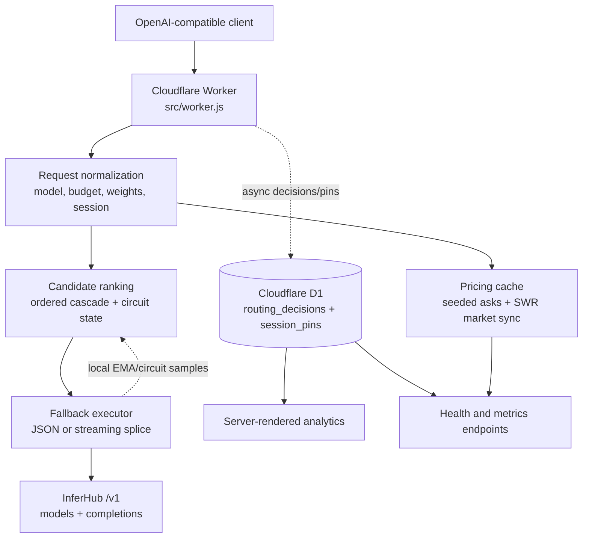

# Infered App Architecture

**Snapshot:** 2026-11-08 EAT  
**Source:** `src/`, `wrangler.jsonc`, `bb.edn`, and the current test runner.  
**Shape:** one dependency-free Cloudflare Worker, backed by InferHub and Cloudflare D1.

## One-page view

The worker is the composition root. It owns HTTP routing and request lifecycle; the router modules own pure data transformations and execution policy. There is no application server, queue, ORM, or npm runtime dependency.

## Request lifecycle

### 1. Edge entry and shared isolate state

`src/worker.js` exports the Cloudflare `fetch(request, env, ctx)` handler. Each Worker isolate lazily creates three in-memory stores:

- **Price cache:** market asks and model-to-provider indexes.
- **Metrics store:** per-node EMA latency/TTFT, failures, circuit state, and usage totals.
- **Cache store:** deterministic JSON responses and short-lived session affinity.

These stores are performance state, not durable state. A new isolate or deployment starts with seeded quotes and empty metrics/cache state.

Every request may trigger stale-while-revalidate market polling. The worker fetches InferHub `/v1/models` in `ctx.waitUntil`, parses ask books, and evicts disappeared nodes. The configured `PRICE_CACHE_TTL_SEC` is present in `wrangler.jsonc`, but the current worker uses a hard-coded 15-second SWR trigger; that is configuration drift, not a separate cache service.

### 2. Request normalization

For `POST /v1/chat/completions`, the worker:

1. Parses the OpenAI-compatible JSON body.
2. Selects the requested model, defaulting to `infered/glm-budget`.
3. Resolves weights and an optional max price from headers, body, query, or environment.
4. Resolves `X-Infered-Tier: strong` to an explicit chain link.
5. Derives session identity from `X-Session-ID`, `X-Session-Affinity`, or a hash of the first user message.
6. Rehydrates a session pin from D1 when the isolate-local pin is absent.
7. Checks the deterministic response cache for non-streaming temperature-zero requests.

The caller's `Authorization` header is used as the upstream key only when `INFERHUB_API_KEY` is absent. That is an important trust-boundary behavior: production should provide the Worker secret so client credentials are not relayed upstream.

### 3. Candidate selection

`src/router/catalog.js` is the model/product registry. It contains:

- Raw model metadata and official prices.
- Five virtual cascade products.
- The default chain and explicit strong links.
- Ceiling exemptions and chain-level fallback declarations.
- Resolution of unknown names to the budget-safe default chain.

`src/router/pricing.js` supplies sorted spot quotes. `src/router/pareto.js` then applies the routing policy:

- Ordered chain position is the primary preference for cascade products.
- The default bounded tier is `$0.50` completion-token price, followed by an unconstrained last-resort tier.
- Official prices are excluded from bounded tiers; the last-resort admission is counted.
- Circuit-open nodes are demoted or excluded.
- Model/session affinity, quality, and latency/failure history influence selection.

For raw registered models, the resolver returns the exact model. For an unknown or retired name, it returns the default budget chain rather than opening the whole market.

### 4. Upstream execution

`src/router/client.js` is the execution boundary:

- Non-streaming requests retry ranked candidates up to 10 attempts.
- Caller aborts propagate to upstream `AbortController`s.
- Candidate failures update the local circuit metrics.
- `CHAIN_FALLBACKS` permits one explicit sibling-chain pass, with attempts summed.

Streaming requests are delegated to `src/router/stream.js`.

### 5. Streaming integrity

The stream executor is the stability-critical component. Its rules are deliberately separate from ordinary JSON retry logic:

- First upstream bytes commit the client-visible response, preserving honest TTFB.
- First-byte wait is bounded at 15 seconds; total pre-commit silence is bounded at 30 seconds.
- An in-band error, bare EOF, or empty `[DONE]` before content is a candidate failure.
- Pre-content failures are withheld and the next candidate is spliced into the same response.
- Content followed by a missing `[DONE]` gets a synthesized sentinel.
- A post-content upstream death cannot be rewound; it is aborted and recorded as a stream death.
- If all candidates fail before content, the client receives an in-band 502 plus `[DONE]`, not a mystery EOF.
- 400/401/403/404 opens are treated as non-retryable model/account failures rather than silently chasing identical nodes.

`TransformStream` connects the executor to the Worker response. `pipeTo(...).catch(...)` absorbs expected cancellation from client disconnects without creating unhandled promise rejections.

## Persistence and observability

Cloudflare D1 is bound as `ROUTING_DB`:

- **`routing_decisions`** stores one durable decision per request: requested chain, actual model/provider, attempts, latency, budget cap, success, and error class.
- **`session_pins`** stores model/provider pins with sliding expiry so affinity survives isolate changes.

D1 writes are asynchronous via `ctx.waitUntil`; failures are logged but never allowed to break routing. Local metrics remain isolate-scoped and are useful for ranking, not global truth.

`src/router/telemetry.js` formats CORS/JSON responses, emits `x-infered-*` headers, and persists decision rows. `src/ui/analytics.js` batches D1 queries and renders server-side HTML at `/` and `/analytics`. `/v1/health` exposes market coverage and local usage; `/v1/metrics` exposes quotes, savings, provider stats, and local usage.

## HTTP surface

| Route | Responsibility |
|---|---|
| `OPTIONS *` | CORS preflight |
| `/` and `/analytics` | Server-rendered D1 analytics and ratecard |
| `/dashboard` | 302 redirect to analytics homepage |
| `/v1/health` | Worker, quote, chain-ask, cache, session, and usage status |
| `/v1/models` | Five virtual cascade products |
| `/v1/metrics` | Quote-level savings plus isolate-local metrics |
| `/v1/admin/sync` | Explicit market refresh when an upstream key is available |
| `/v1/chat/completions` | OpenAI-compatible JSON and SSE completion proxy |
| anything else | JSON 404 |

## Complexity map

| Component | Role | Utility verdict |
|---|---|---|
| `worker.js` | Composition root and HTTP surface | Essential; keep thin |
| `catalog.js` | Data-driven products and resolution | Essential; plain data is the right abstraction |
| `pricing.js` | Ask ingestion, eviction, savings | Essential; market truth lives here |
| `pareto.js` | Eligibility, cascade, circuit-aware ranking | Essential; the policy boundary |
| `client.js` | JSON execution and chain fallback | Essential; separate from stream protocol |
| `stream.js` | SSE classification, splice, integrity | Essential but near the 500-LOC ceiling; natural future seam |
| `session.js` / `cache.js` | Fingerprint pins and deterministic cache | Useful; isolate-local cache is acceleration, D1 is truth |
| `metrics.js` | EMA ranking and circuit breaker | Useful for node selection; totals are not global analytics |
| `telemetry.js` | Headers, CORS, D1 writes | Essential boundary; never let D1 failure stop a request |
| `analytics.js` | Read-only server-rendered observability | Useful, low coupling |

## Stability boundaries

The app has four independent failure domains:

1. **Client/runtime path:** caller timeouts or disconnects.
2. **Worker/router path:** parsing, ranking, stream classification, or CPU/subrequest limits.
3. **InferHub path:** capacity, rate limits, disabled models, in-band 502s, and truncated streams.
4. **Observability path:** D1 latency or write failure.

The intended design is that only the second domain should directly fail the request; the router bounds and classifies upstream failures, and observability degrades without taking the data path down. The current architecture is therefore a small edge state machine around a pure data catalog—not a general model platform.
